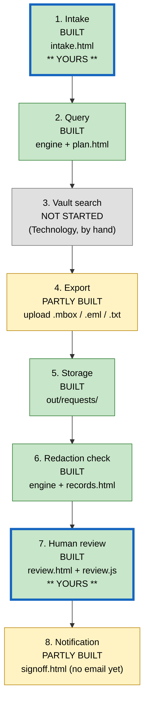
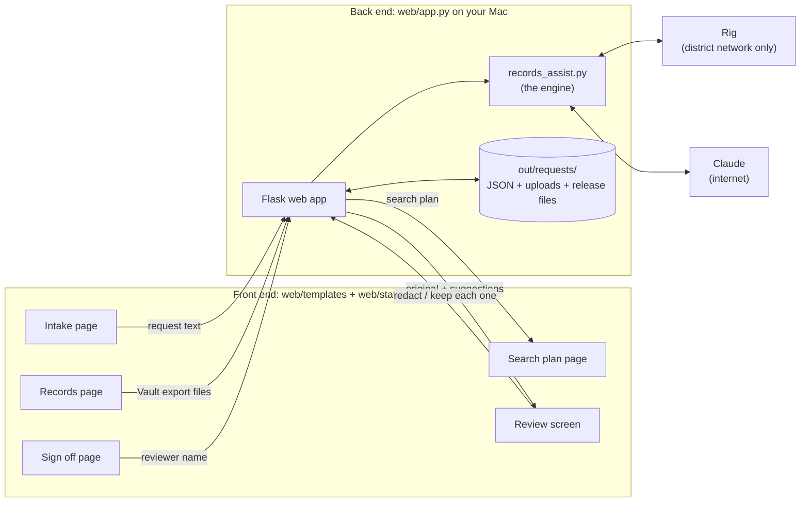

# Repo map: af-records-assist

Plain-language map of this repo for Mike. First written 2026-10-26; updated the same evening when the web app was
added. The engine (`records_assist.py`) was not changed.

> The diagrams below are Mermaid. They draw themselves on GitHub. In VS Code, install the extension
> "Markdown Preview Mermaid Support", then open this file and press Cmd+Shift+V.

## 1. Big picture

The repo has two layers. The **engine** is `records_assist.py`, the script Luke built: it writes a Google Vault
search plan from a request and proposes redactions on email text. The **web app** in `web/` is a browser front end
built on top of it: staff paste a request, approve the plan, add the Vault export, review redactions side by side,
and sign off. The web app calls the engine's code directly, so the AI logic lives in one place.

| File or folder | What it is | Front end or back end |
|---|---|---|
| `records_assist.py` | The engine. Two commands: `query` (step 2) and `redact` (step 6). | Back end |
| `web/app.py` | The web app's server: pages, saving requests, calling the engine. | Back end |
| `web/templates/` | One HTML file per page (intake, plan, records, review, sign off). | Front end |
| `web/static/` | The look (`style.css`) and the clickable parts (`review.js`, `records.js`, `app.js`). | Front end |
| `web/README.md` | How the web app works and how it uses the engine. | Docs |
| `README.md`, `docs/2026-10-26-decisions.md` | Luke's README and the decisions from the 10-26 meeting. | Docs |
| `samples/` | Fictional request and emails, plus `samples/benchmark/` (5 more emails and an answer key). | Test data |
| `benchmark.py` | Scores the rig against Claude on the samples. | Testing |
| `calibrate_costs.py` | Measures what the sample request and emails really cost on Claude, for the estimate's defaults. | Testing |
| `tests/test_costs.py` | Tests for the cost tally and the estimate (no model calls). | Testing |
| `out/` | Everything saved on your Mac: requests, uploads, release files, test results. Never uploaded to GitHub. | Data |

## 2. Status of the 8 steps

| # | Step | Status | Where it lives | Notes |
|---|---|---|---|---|
| 1 | Intake | BUILT (prototype) | `web/templates/intake.html`, `web/app.py` (`create_request`) | Paste, or upload .eml or .txt. |
| 2 | Query | BUILT (prototype) | Engine: `QUERY_SYSTEM`, `clean_terms`. Page: `web/templates/plan.html` | Copy buttons and a handoff note for Technology. |
| 3 | Vault search | NOT STARTED (manual) | `web/templates/records.html` shows the terms and saves the Count | Technology runs it in Vault by hand. |
| 3b | Estimate | BUILT (prototype) | `estimate` in `web/app.py`, the estimate card in `records.html` | AI cost from real token counts plus $1 per page; email to the requester; their answer recorded. |
| 4 | Export | PARTLY BUILT | `web/app.py` (`records_from_file`) | Reads .mbox, .eml and .txt uploads. Exporting from Vault is still by hand. |
| 5 | Storage | BUILT (prototype) | `out/requests/<id>/exports/` | Saved on your Mac for now; a shared location comes with hosting. |
| 6 | Redaction check | BUILT (prototype) | Engine: `REDACT_SYSTEM`, `PATTERNS`. Web: `check_record` | Rig, Claude, or both side by side. |
| 7 | Human review | BUILT (prototype) | `web/templates/review.html`, `web/static/review.js` | Original vs redacted preview, rig vs Claude labels, approve or keep each, add missed ones. |
| 8 | Notification | PARTLY BUILT | `web/templates/signoff.html` | Sign-off saves the release files and a log. Email waits for hosting. |

## 3. Flow diagram



Key: green = built, yellow = partly built, grey = not started. A thick blue border marks your two pieces.

## 4. Front end and back end



## 5. How to run it on your Mac

```
cd /Users/mriley/Documents/_WebAppProjects/2-In-Progress/af-records-assist
./run-web.sh
```

Then open **http://localhost:8000**. Press Ctrl+C in Terminal to stop it. `run-web.sh` loads your Claude key from the
Keychain; it is a local helper and is not on GitHub.

- **Claude** works anywhere with internet.
- **The rig** works only on the district network at the office (the VPN does not reach it today).
- **Google Vault:** the app never touches Vault, so you need no Vault access. Connecting it later is back-end setup a
  Google admin does once: a Google Cloud project with the Vault API on, and a service account allowed to act for one
  Vault-licensed admin (Google calls this "domain-wide delegation"). Brandon or Xavier would own that.

The command-line version still works exactly as before (`python3 records_assist.py query ...`).

## 6. Your pieces

**Intake page:** `web/templates/intake.html`

- Sends: the request text (or an uploaded .eml or .txt), requester name and contact, date received, which model
  drafts the plan, and the "fictional" confirmation.
- Gets back: the request number, then the search plan page. The plan has a summary, the underlying need, what the
  request leaves open, questions for the requester, likely record holders, scope, a date range, Gmail and Drive
  terms, likely exemptions, and notes.

**Review screen:** `web/templates/review.html` (layout) and `web/static/review.js` (the clicking)

- Gets: the record text and its list of suggestions. Each suggestion has its position in the text (`start`, `end`),
  the words, a `category` (FERPA, MEDICAL, and so on), who found it (`found_by`: rules, rig, Claude, you), each
  model's `reasons`, and the `decision` (pending, approve, reject).
- Sends back: the whole list after every click, with each decision and any redaction you added by selecting text.
- The look is all in `web/static/style.css`. Colours are set once at the top of that file.

## 7. Questions for the developer

1. Is the Linux VM on the rack host the right future home for this Python web app?
2. Should `cmd_query` and `cmd_redact` each get a small function that returns results, so the web app can call them instead of repeating a few lines?
3. Will Brandon or Xavier set up the Vault API service account, so neither of us needs Vault access?
4. Will Vault exports come as .mbox for Gmail (which the app reads today)?
5. Should the release files become PDFs with the redactions burned in?
6. Can real record content go to Claude for redaction, or must it stay on the rig?
7. Can the rig accept requests from VPN addresses, so this can run from home?
8. Should sign-in use the district platform sign-in, limited to records staff, once it is hosted?
9. Should the "done" notice be an email through the district mail relay?
10. Should I push the web app, `benchmark.py` and the samples to the repo on a branch for you to review?
